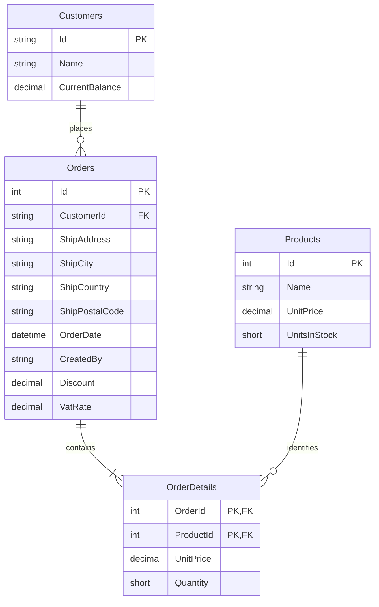

# Normalized sales data model

Each table has a primary key and atomic fields. Order lines depend on the entire `(OrderId, ProductId)` key, which also enforces one line per product. Customer and current product information are stored once. Historical line price depends on the order/product pair and may differ from today's product price. Derived subtotals, discounts, VAT amounts and grand totals are calculated from saved values rather than duplicated across tables.

Foreign keys restrict removal of referenced customers/products and cascade order deletion to its details. A database check constraint prevents negative inventory. Identity tables handle users, claims, tokens and roles. DomainLogs stores an independent audit trail; the creator's username is an audit snapshot rather than a mutable display-name lookup.

SQL Server and PostgreSQL use the same entity model with independent provider-specific migrations. No customer/product maintenance endpoints are required by the assignment.
