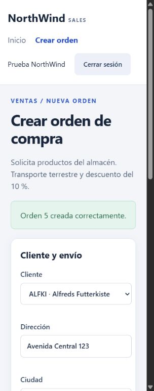

> Historical .NET 8 baseline. Superseded by [NET10-VERIFICATION.md](NET10-VERIFICATION.md) and [SEMESTER-REQUIREMENTS.md](SEMESTER-REQUIREMENTS.md).

# Verificación de la solución

Reorganización actualizada el 20 de octubre de 2026. Las evidencias HTTP/SMTP del 16 de octubre se identifican como históricas.

- 31 proyectos de producto en cuatro capas; pruebas aparte en `tests/NorthWind.Tests`. Todos destinados a **net8.0**, con C# 12.
- Compilación: **0 errores y 0 advertencias**.
- Pruebas automatizadas: **54 aprobadas, 0 fallidas, 0 omitidas**, incluida integración con SQL Server.
- HTTP repetido el 20 de octubre: **14 casos aprobados** y **2 comprobaciones del contenido de los errores por campo**.
- API, Swagger y las cuatro bibliotecas del cliente reorganizado: recursos disponibles.
- Correo actual: la orden especial 19 generó un archivo .eml mediante el gateway en modo local. La configuración SMTP de Mailtrap no se cambió.
- Swagger y catálogos protegidos: comprobados.
- Esquema EF: sin diferencias pendientes respecto de la última migración; se mantienen las 13 tablas.
- En la revisión del 16 de octubre, la orden especial **15** fue procesada y el transporte SMTP de Mailtrap aceptó el mensaje.

Se corrigieron los puertos y presentadores de membresía, la separación del repositorio de auditoría, los estados HTTP de error y la serialización de errores de validación. La prueba de regresión de esta última detectó y permitió corregir la omisión de la lista de errores en respuestas 400.

El [informe comparativo completo](REVISION-FINAL.md) distingue lo comprobado de las adaptaciones frente a los PDF. La solución tiene equivalencias funcionales y la distribución de proyectos de las capturas; no es una copia literal de todos los proyectos, firmas y componentes de las guías.

Evidencias locales:

- `artifacts/Reorganizacion/Reorganizacion.trx`: suite actual de 54 pruebas
- `artifacts/RevisionFinal/RevisionFinal.trx`: suite histórica
- `artifacts/Reorganizacion/Http-Smoke.log`: HTTP actual
- `artifacts/RevisionFinal/Http-Smoke.log`: HTTP histórico

La prueba SQL crea una orden de prueba y verifica que una segunda orden se cancele por completo cuando falla una notificación simulada. No se usan credenciales SMTP en esa prueba. El script HTTP sí envía una orden especial al sandbox configurado.

La prueba visual inicial de Blazor comprobó login, creación, recarga de sesión y logout. No se afirma haber repetido esa prueba visual en la revisión actual ni haber abierto la bandeja de Mailtrap para verificar su representación.

Los datos de prueba se conservan en NorthWindPracticas8 para inspección.

