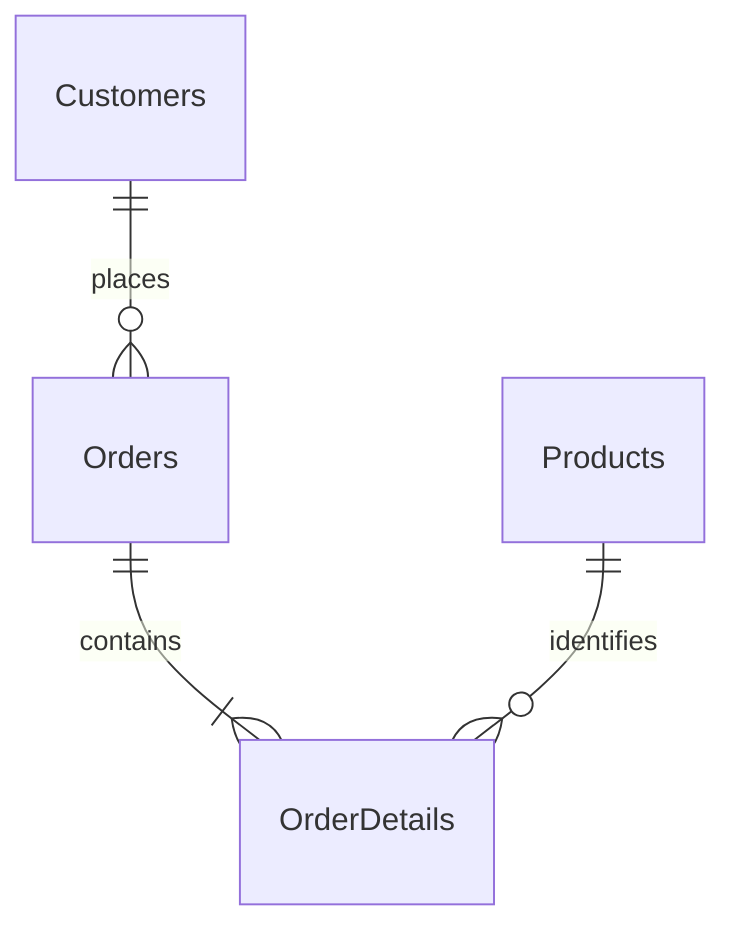

# Arquitectura y modelo para reconstruir NorthWind

Contrato complementario de [SPEC.md](../../SPEC.md), versión 1.0. SYS-02/04/19/29/30/31.

## Distribución física y de solución

Crear `NorthWind.sln`, `Directory.Build.props` con `net10.0`, C# 14, nullable e implicit usings habilitados y compilación determinista. La solución tiene exactamente estos 31 proyectos de producto, todos con implementación real. Pruebas en `tests/NorthWind.Tests`, fuera del .sln. React es una aplicación independiente, no un .csproj adicional.

```text
src/
├── 1. Enterprise Business Rules/
│   ├── NorthWind.DomainLogs.Entities
│   ├── NorthWind.Entities
│   ├── NorthWind.Events.Entities
│   ├── NorthWind.Exceptions.Entities
│   ├── NorthWind.HttpDelegatingHandlers
│   ├── NorthWind.Membership.Entities
│   ├── NorthWind.Result.Entities
│   ├── NorthWind.Sales.Entities
│   ├── NorthWind.Sales.Validators.Entities
│   ├── NorthWind.Transactions.Entities
│   └── NorthWind.Validation.Entities
├── 2. Application Business Rules/
│   ├── NorthWind.Membership.Backend.Core
│   ├── NorthWind.Sales.Backend.BusinessObjects
│   ├── NorthWind.Sales.Backend.UseCases
│   └── NorthWind.Sales.Frontend.BusinessObjects
├── 3. Interface Adapters/
│   ├── Controllers/NorthWind.Sales.Backend.Controllers
│   ├── Gateways/
│   │   ├── EmailGateways/NorthWind.Sales.Backend.SmtpGateways
│   │   ├── Repositories/NorthWind.Sales.Backend.Repositories
│   │   └── WebApiGateways/NorthWind.Sales.Frontend.WebApiGateways
│   ├── Presenters/NorthWind.Sales.Backend.Presenters
│   └── Views/
│       ├── NorthWind.Membership.Frontend.RazorViews
│       ├── NorthWind.RazorComponents
│       └── NorthWind.Sales.Frontend.Views
└── 4. Frameworks And Drivers/
    ├── Frameworks/
    │   ├── NorthWind.Membership.Backend.AspNetIdentity
    │   └── NorthWind.Sales.Backend.DataContexts.EFCore
    ├── IoC/
    │   ├── NorthWind.Sales.Backend.IoC
    │   └── NorthWind.Sales.Frontend.IoC
    ├── Libraries/
    │   ├── NorthWind.UserServices
    │   └── NorthWind.ValidationService.FluentValidation
    ├── UI/NorthWind.Sales.WebApi
    └── UIs/NorthWind.Sales.BlazorClient
frontends/northwind-sdd/
tests/NorthWind.Tests/
specs/000-northwind-system/
docs/
tools/
```

## Responsabilidades y dirección de dependencias

| Capa/módulo | Responsabilidad |
|---|---|
| Enterprise: Entities | Specification base e interfaces de servicios de usuario/correo. |
| Enterprise: Sales/Membership | DTO, rutas y límites compartidos, sin depender de EF/Identity/UI. |
| Enterprise: Validation/Sales.Validators | Errores, restricciones y hub de validación; reglas de forma de venta. |
| Enterprise: Events/Transactions/DomainLogs | Contratos de eventos, transacción y auditoría. |
| Enterprise: Result/Exceptions/HttpDelegatingHandlers | Resultado tipado, excepciones y transporte HTTP común del cliente. |
| Application: Sales.Backend.BusinessObjects | Orden/agregado/detalle, enums, Specification especial, puertos y repositorios abstractos. |
| Application: Sales.Backend.UseCases | Interactor de creación, validadores de negocio, logger y manejador del evento especial. |
| Application: Membership.Backend.Core | Casos de registro/login y puertos de servicio de membresía/token. |
| Application: Sales.Frontend.BusinessObjects | ViewModel de venta y contratos del gateway de Blazor. |
| Adapters: Controllers/Presenters | Mapear HTTP a puertos y convertir salida del caso de uso; no SQL en endpoints. |
| Adapters: Repositories | Entidades de persistencia, contratos de contexto, comandos/consultas y logs. |
| Adapters: SMTP/WebApiGateways | Implementar correo y consumo HTTP de Blazor. |
| Adapters: Views/RazorComponents | Formularios/membresía, catálogos, factura, historial y avisos reutilizables. |
| Frameworks: EFCore/Identity | DbContext, proveedores/migraciones/semilla, transacción real, Identity y JWT. |
| IoC/Libraries/UI | Registro DI, IUserService/validación concreta, host API, PDF y arranque Blazor. |

Regla: lo externo referencia abstracciones internas, no al revés. Casos de uso no conocen `HttpContext`, `DbContext`, SMTP ni PDF. Repositorios reciben interfaces de contexto implementadas en EF. El composition root conecta servicios scoped a la misma instancia de contexto para compartir transacción. React se organiza en `src/domain`, `src/api`, sesión/avisos, páginas y componentes; no referencia ensamblados C#.

La API conserva `Program.cs`, `Startup.cs`, `GlobalUsings.cs`, `Extensions` y configuración. Blazor conserva `Layout`, `NavMenu.razor`, `LiveClock.razor`, `Pages`, `App.razor`, `Program.cs` y `wwwroot`.

## Modelo relacional normalizado

| Tabla | Columnas y reglas |
|---|---|
| Customers | `Id char(5)` PK, `Name varchar(100)` requerido, `CurrentBalance decimal(12,2)` requerido. |
| Products | `Id int` PK, `Name varchar(40)` requerido, `UnitPrice decimal(8,2)`, `UnitsInStock smallint`; CHECK stock >= 0. |
| Orders | `Id int` PK generado, `CustomerId char(5)` FK, `ShipAddress varchar(60)`, `ShipCity varchar(15)`, `ShipCountry varchar(15)` requeridos, `ShipPostalCode varchar(10)` nullable; `ShippingType int`, `DiscountType int`, `Discount decimal(8,2)`, `VatRate decimal(5,4)` default 0, `OrderDate` fecha/hora UTC, `CreatedBy varchar(256)` requerido. |
| OrderDetails | PK compuesta (`OrderId`,`ProductId`), ambas FK; `UnitPrice decimal(8,2)`, `Quantity smallint`. |
| DomainLogs | `Id int` PK generado, `DateTime` fecha/hora UTC, `Information varchar(1000)` requerido, `UserName varchar(256)` requerido. |
| AspNetUsers | Identity estándar más `FirstName`, `LastName` hasta 100 en almacenamiento (contrato de ingreso 30); `NormalizedEmail` único. Hashes, sellos de seguridad y lockout administrados por Identity. |
| AspNetRoles / AspNetRoleClaims / AspNetUserClaims / AspNetUserLogins / AspNetUserRoles / AspNetUserTokens | Esquema estándar de ASP.NET Identity; no se borra porque una tabla esté vacía. |
| __EFMigrationsHistory | Control de migraciones por proveedor. |

Los tipos de texto deben soportar Unicode; SQL Server usa el equivalente Unicode. PostgreSQL usa `timestamp with time zone` para instantes UTC; SQL Server `datetimeoffset`. IDs de usuario/roles y relaciones Identity los define su proveedor estándar; no sustituirlo por contraseñas propias.



FK Customers→Orders y Products→OrderDetails con eliminación restrictiva; Orders→OrderDetails con cascada. No se expone API de borrado de venta. `CreatedBy` es un snapshot de correo, no una FK Identity ni un usuario elegible por el navegador. Totales derivados no se duplican en tablas. Precio histórico depende de la pareja orden/producto; descuento/tasa se guardan en encabezado. Nombres de catálogo no se guardan como snapshot en este alcance.

Enums de referencia: `ShippingType { Sea=0, Air=1, Rail=2, Road=3 }`; `DiscountType { Flat=0, Percentage=1 }`. Nueva orden usa Road, Percentage, Discount=10. El cliente no escoge esos valores ni los envía. No implementar descuento plano en pantallas solo porque exista el enum.

Migraciones independientes SQL Server/PostgreSQL; no reutilizar SQL de un proveedor en otro. Inicializar base nueva sin exigir una copia de la base de defensa. Nunca ejecutar EnsureDeleted ni borrar tablas para actualizar una instalación con datos. En actualización, migración aditiva y respaldo según entorno.

## Semilla reproducible

| Cliente | Nombre | Saldo |
|---|---|---:|
| ALFKI | Alfreds Futterkiste | 0.00 |
| ANATR | Ana Trujillo Emparedados y helados | 0.00 |
| ANTON | Antonio Moreno Taquería | 100.00 |

| Producto | Nombre | Precio | Stock |
|---|---|---:|---:|
| 1 | Chai | 35.00 | 20 |
| 2 | Chang | 55.00 | 0 |
| 3 | Aniseed Syrup | 65.00 | 20 |
| 4 | Chef Anton's Cajun Seasoning | 75.00 | 40 |
| 5 | Chef Anton's Gumbo Mix | 50.00 | 20 |

No sembrar cuentas con contraseñas comunes. Cada operador registra su cuenta. Las ventas consumen stock: los fixtures de prueba se restablecen únicamente en base aislada.

## Configuración y ejecución

| Clave de configuración .NET | Valor/semántica |
|---|---|
| ConnectionStrings:NorthWind | Cadena privada al proveedor elegido. |
| Database:Provider | `PostgreSql` en Debian, `SqlServer` opcional en Windows. |
| Database:ApplyMigrations | false normalmente en servicio publicado; true al inicializar demo/controlar migración. |
| JwtOptions:SecurityKey | Privada, al menos 32 bytes; no incluir en appsettings ni SPA. |
| JwtOptions:ValidIssuer / ValidAudience / ExpireInMinutes | NorthWind / NorthWind.Client / 30. |
| SalesSettings:VatRate | 0.15 para demo; rango 0–1, persistir por orden. |
| SmtpOptions:Mode / PickupDirectory | PickupDirectory / App_Data/mail por defecto. |
| SmtpOptions:SmtpHost / SmtpHostPort / EnableSsl | Configurables; para sandbox ejemplo host Mailtrap, 587, true STARTTLS. |
| SmtpOptions:SmtpUserName / SmtpPassword | Privados; vacíos en modo local. |
| SmtpOptions:SenderEmail / AdministratorEmail | northwind@example.com / admin@example.com como direcciones de demostración. |
| AllowedOrigins | Blazor `http://localhost:5200`; React usa proxy mismo origen. No usar wildcard con credenciales. |
| AllowedHosts | localhost;127.0.0.1 para demo local. |
| Swagger:Enabled | false en producción salvo habilitación explícita para defensa; Development habilita visor. |

Variables de entorno .NET usan `__` para `:`. Compose admite `.env` con `POSTGRES_PASSWORD`, `JWT_SECURITY_KEY`, `SMTP_MODE`, `SMTP_USERNAME`, `SMTP_PASSWORD`; el host SMTP también debe fijarse mediante configuración de API si se habilita envío externo. Generar secretos aleatorios de cada copia (referencia: 24 bytes para password PostgreSQL y 64 para JWT, codificados en hex). No sobreescribir `.env` existente; no imprimir valores.

Contenedores de referencia: Debian 13 con SDK .NET 10 para compilar/API/Blazor, PostgreSQL 17.11 con comprobación `pg_isready`; API espera DB saludable. Puertos host loopback 5100,5200; DB opcional loopback54330→5432. Volúmenes persistentes para datos y `.eml`; perfil `frontend` activa Blazor. React5300 puede ejecutarse fuera del contenedor con Node24 o servir dist en Debian con Python3. Dependencias/fontconfig/fuentes Unicode disponibles para PDF QuestPDF en Linux.

Herramientas a crear: `tools/init-demo-env.mjs`, `tools/start-team-demo.mjs`, wrappers `.sh`/`.ps1`, `compose.yaml`, `Dockerfile.debian`, `.env.example` sin secretos, `.gitignore`/`.dockerignore`; scripts de backend/Blazor, smoke test con base aislada y guía de defensa. El arranque Node evita tener que cambiar políticas de ejecución PowerShell. No automatizar instalación privilegiada sin identificar qué requiere permisos.

La ejecución nativa publicada usa directorio de publicación, `.env` privado, servicio systemd `northwind-api` con usuario sin privilegios, WorkingDirectory correcto y reinicio configurado; no requiere sudo para operaciones de ventas. Evitar dobles procesos/puertos ocupados. Proxy React gestionado por PID propio y log; declarar si necesita reiniciarse tras reboot. Si se usa SSH, túneles loopback; no incrustar IP/contraseña del autor. Apagar VM detiene servicios allí alojados.

`/health` informa runtime/OS reales y estado de proceso; no afirmar que sea una comprobación completa de base de datos. HTTPS, dominio, proxy público, backups productivos y outbox son decisiones de un despliegue futuro, no requisitos ya satisfechos por esta demo.
